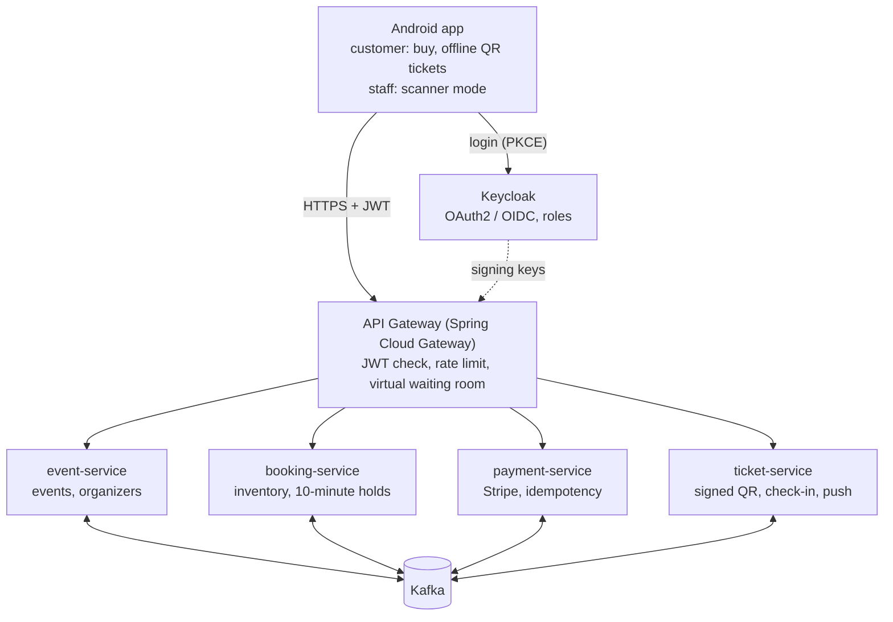

# Architecture

Where TicketRush is heading over the 12-video series. Video 1 starts with a single `booking-service`; the rest of this picture is built step by step.

Each service owns its own PostgreSQL database and never reads another service's tables. Services talk to each other only through Kafka events published with the transactional outbox pattern.

## Where we are

| Video | What exists after it |
| --- | --- |
| 1 | `booking-service` with a naive reservation endpoint that oversells under load |
| 2 | Four fixes for overselling, benchmarked; 10-minute holds |
| 3 | Split into `event-service`, `booking-service` and the gateway |
| 4 | Keycloak and role-based security |
| 5 to 7 | Payments, Kafka saga, signed tickets |
| 8 to 10 | Android app |
| 11 to 12 | Load test with 10,000 users, deployment |

The full specification is in [spec.md](spec.md). Decisions are recorded in [adr/](adr/).
