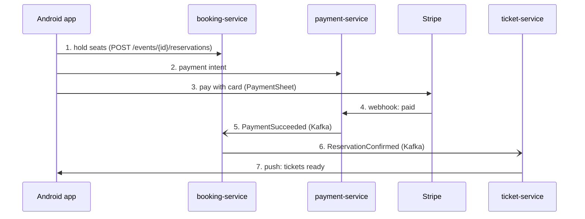
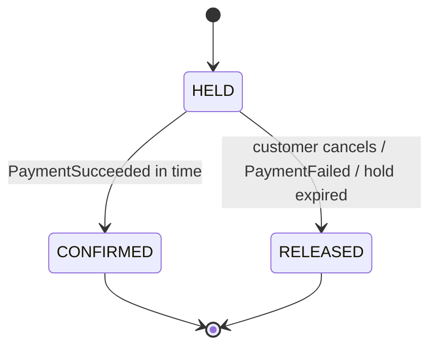

# TicketRush: Technical Specification

TicketRush sells event tickets without ever selling more than the venue holds, survives 10,000 buyers in the same second, and issues QR tickets that can be verified offline. This spec is the target for the whole 12-video series; each video implements part of it.

## 1. Goals, users and requirements

The one hard rule: **sold tickets never exceed capacity**, under any load, retry or failure.

| Role | Uses | Main job |
| --- | --- | --- |
| Organizer | REST API in v1 | Create an event with capacity, price and sale start; see sales |
| Customer | Android app | Browse events, hold seats, pay, keep tickets offline |
| Staff | Android app, scanner mode | Scan tickets at the door, also without internet |

**In scope for v1:** general admission events, 1 to 6 tickets per purchase, 10-minute seat holds, card payment via Stripe test mode, signed QR tickets, push notification on ticket issue, virtual waiting room for high-demand sales.

**Out of scope for v1:** reserved seating maps, refunds requested by customers, resale, web admin UI, multiple currencies per event, email delivery.

| ID | Requirement | Target | Verified in |
| --- | --- | --- | --- |
| NFR-1 | No overselling | 0 oversold tickets in every load test and integration test | Video 2, 11 |
| NFR-2 | Concurrent buyers | 10,000 virtual users in one sale with no errors other than 409 sold out or 429 queued | Video 11 |
| NFR-3 | Reservation latency | p95 under 300 ms at 1,000 requests per second on one booking-service instance | Video 2, 11 |
| NFR-4 | No double charge | Repeating a payment request with the same Idempotency-Key charges once | Video 5 |
| NFR-5 | No lost purchase | A paid reservation always ends with a ticket, even if a service restarts mid-flow | Video 6 |
| NFR-6 | Offline tickets | Tickets display and verify with no network on customer and staff devices | Video 10 |
| NFR-7 | Reproducible | `docker compose up` plus one Gradle command runs everything locally | Video 1 onward |

NFR-2 and NFR-3 are starting goals for a laptop; the load-test videos report the real numbers.

## 2. User stories

**US-1 Organizer creates an event** (videos 3, 4)
- Organizer creates an event with name, venue, start time, sale start time, capacity (1 to 100,000), price in cents and currency.
- A new event is DRAFT; publishing moves it to ON_SALE at sale start time.
- Capacity cannot be lowered below the number of tickets already sold or held.
- Only ORGANIZER users can create or edit, and only their own events.

**US-2 Customer browses events** (video 8)
- The app lists ON_SALE and upcoming events with availability shown as a band ("plenty", "few left", "sold out"), never the exact number.
- Browsing works without login.

**US-3 Customer holds seats** (videos 1, 2, 9)
- Customer holds 1 to 6 tickets of one event; a hold lasts 10 minutes.
- If fewer seats remain than requested, the request fails with 409 and nothing is held.
- Repeating a request with the same Idempotency-Key returns the same hold, never a second one.
- At most one active hold per customer per event.
- An expired hold returns its seats within 30 seconds of expiry.

**US-4 Customer pays** (videos 5, 9)
- Customer pays with a card through Stripe PaymentSheet.
- A double tap, app restart or network retry never charges twice.
- Paying after the hold expired is refused before any charge; if Stripe already charged, the payment is refunded automatically.

**US-5 Customer receives tickets** (videos 6, 7, 10)
- Within 10 seconds of payment, tickets appear in the app and a push notification is sent.
- Each ticket shows a QR code that renders with no network.
- A forged or edited ticket fails the signature check.

**US-6 Staff checks in tickets** (videos 7, 10)
- Staff scans a QR code and sees VALID, ALREADY USED or INVALID within 1 second.
- Scanning works offline with the cached public key; offline check-ins sync later.
- A ticket scanned on two devices is accepted once; the conflict is logged.

**US-7 High-demand sale** (video 11)
- When demand is above the configured rate, customers enter a waiting room and see their position.
- Customers leave in arrival order with a pass valid for 5 minutes.
- Requests without a valid pass during a queued sale get 429 with Retry-After.

## 3. Purchase flow



1. **Hold seats.** One atomic conditional UPDATE on `inventory.available`, a HELD reservation that expires in 10 minutes, and ReservationCreated in the outbox, all in one transaction.
2. **Payment intent.** payment-service creates a Stripe PaymentIntent, using the reservation ID as Stripe's idempotency key.
3. **Pay.** Card data never touches our servers.
4. **Webhook.** Signature verified, payment marked SUCCEEDED.
5. **PaymentSucceeded.** booking-service confirms if the reservation is still HELD; otherwise it releases it and payment-service refunds.
6. **ReservationConfirmed.** ticket-service issues one signed ticket per seat.
7. **Push.** The app fetches `GET /me/tickets` and stores them for offline use.

## 4. Reservation lifecycle



CONFIRMED and RELEASED are final. Every move into RELEASED returns the seats with one atomic UPDATE in the same transaction and stores `release_reason` (CANCELLED, PAYMENT_FAILED or EXPIRED). The expiry job runs every 10 seconds and claims due holds with `FOR UPDATE SKIP LOCKED`. A PaymentSucceeded that arrives after RELEASED triggers an automatic refund.

## 5. API contracts

All endpoints sit behind the gateway at `/api`, speak JSON, and return errors as RFC 9457 Problem Details. Money is integer cents plus an ISO 4217 currency. Times are ISO 8601 in UTC.

| Method and path | Role | Success | Errors |
| --- | --- | --- | --- |
| GET /events | public | 200 page of events | |
| GET /events/{id} | public | 200 event | 404 |
| POST /events | ORGANIZER | 201 event | 400, 403 |
| PUT /events/{id} | ORGANIZER (owner) | 200 event | 400, 403, 404, 409 capacity below sold |
| POST /events/{id}/publish | ORGANIZER (owner) | 200 event | 403, 404, 409 wrong state |
| POST /events/{id}/reservations | CUSTOMER | 201 reservation | 400, 404, 409 sold out or active hold, 422 sale not open, 429 queued |
| GET /reservations/{id} | CUSTOMER (owner) | 200 reservation | 403, 404 |
| DELETE /reservations/{id} | CUSTOMER (owner) | 204 | 403, 404, 409 already paid |
| POST /reservations/{id}/payment-intent | CUSTOMER (owner) | 200 client secret | 404, 409 not HELD, 410 expired |
| POST /webhooks/stripe | Stripe signature | 200 | 400 bad signature |
| GET /me/tickets | CUSTOMER | 200 tickets | |
| POST /me/devices | CUSTOMER | 204 | 400 |
| GET /tickets/keys | public | 200 JWK set | |
| POST /tickets/check-ins | STAFF | 200 result | 400 |
| GET /queue/{eventId} | CUSTOMER | 200 position or pass | 404 |

```http
POST /api/events/42/reservations
Authorization: Bearer <access token>
Idempotency-Key: 6f1c2b7e-1a2d-4c1e-9f0a-3b9d8e7c6a51
Content-Type: application/json

{ "quantity": 2 }
```

```json
{
  "id": "0193a1b2-7c4d-7e8f-9a0b-1c2d3e4f5a6b",
  "eventId": 42,
  "quantity": 2,
  "status": "HELD",
  "amount": { "cents": 9000, "currency": "EUR" },
  "expiresAt": "2026-11-14T18:10:00Z"
}
```

```json
{
  "type": "/problems/sold-out",
  "title": "Not enough tickets left",
  "status": 409,
  "detail": "Requested 2, available 1.",
  "instance": "/api/events/42/reservations",
  "eventId": 42
}
```

**Idempotency rules**
- Required on reservation and payment-intent POSTs; a missing key returns 400.
- The key is a client-generated UUID, scoped to user and endpoint, kept for 24 hours.
- Same key and same body returns the stored response with `Idempotent-Replayed: true`.
- Same key with a different body returns 422; a request still in progress returns 409 with Retry-After: 1.

Check-in `result` is one of VALID, ALREADY_USED, INVALID_SIGNATURE, WRONG_EVENT.

## 6. Database schemas

One PostgreSQL database per service, migrated with Flyway. The `available` column and its CHECK constraint are the last line of defense against overselling.

```sql
-- event-service
CREATE TABLE events (
    id             BIGSERIAL PRIMARY KEY,
    organizer_id   UUID         NOT NULL,
    name           VARCHAR(200) NOT NULL,
    venue          VARCHAR(200) NOT NULL,
    starts_at      TIMESTAMPTZ  NOT NULL,
    sale_starts_at TIMESTAMPTZ  NOT NULL,
    capacity       INT          NOT NULL CHECK (capacity BETWEEN 1 AND 100000),
    price_cents    INT          NOT NULL CHECK (price_cents >= 0),
    currency       CHAR(3)      NOT NULL,
    status         VARCHAR(20)  NOT NULL,
    version        BIGINT       NOT NULL DEFAULT 0
);

-- booking-service
CREATE TABLE inventory (
    event_id    BIGINT  PRIMARY KEY,
    capacity    INT     NOT NULL,
    available   INT     NOT NULL,
    price_cents INT     NOT NULL,
    currency    CHAR(3) NOT NULL,
    sale_open   BOOLEAN NOT NULL DEFAULT FALSE,
    CONSTRAINT available_in_range CHECK (available BETWEEN 0 AND capacity)
);

CREATE TABLE reservations (
    id             UUID PRIMARY KEY,
    event_id       BIGINT      NOT NULL REFERENCES inventory (event_id),
    user_id        UUID        NOT NULL,
    quantity       INT         NOT NULL CHECK (quantity BETWEEN 1 AND 6),
    amount_cents   INT         NOT NULL,
    currency       CHAR(3)     NOT NULL,
    status         VARCHAR(20) NOT NULL, -- HELD, CONFIRMED, RELEASED
    release_reason VARCHAR(20),          -- CANCELLED, PAYMENT_FAILED, EXPIRED
    expires_at     TIMESTAMPTZ NOT NULL,
    created_at     TIMESTAMPTZ NOT NULL,
    version        BIGINT      NOT NULL DEFAULT 0
);

CREATE UNIQUE INDEX one_active_hold ON reservations (event_id, user_id) WHERE status = 'HELD';
CREATE INDEX reservations_expiring ON reservations (expires_at) WHERE status = 'HELD';

-- in each service that needs them
CREATE TABLE idempotency_keys (
    user_id       UUID         NOT NULL,
    endpoint      VARCHAR(100) NOT NULL,
    idem_key      UUID         NOT NULL,
    request_hash  CHAR(64)     NOT NULL,
    status        VARCHAR(20)  NOT NULL, -- IN_PROGRESS, COMPLETED
    response_code INT,
    response_body JSONB,
    created_at    TIMESTAMPTZ  NOT NULL,
    PRIMARY KEY (user_id, endpoint, idem_key)
);

CREATE TABLE outbox (
    id             UUID PRIMARY KEY,
    aggregate_type VARCHAR(50)  NOT NULL,
    aggregate_id   VARCHAR(100) NOT NULL,
    event_type     VARCHAR(100) NOT NULL,
    payload        JSONB        NOT NULL,
    created_at     TIMESTAMPTZ  NOT NULL,
    published_at   TIMESTAMPTZ
);
CREATE INDEX outbox_unpublished ON outbox (created_at) WHERE published_at IS NULL;

CREATE TABLE processed_messages (
    message_id   UUID PRIMARY KEY,
    processed_at TIMESTAMPTZ NOT NULL
);

-- payment-service
CREATE TABLE payments (
    id                       UUID PRIMARY KEY,
    reservation_id           UUID         NOT NULL UNIQUE,
    user_id                  UUID         NOT NULL,
    amount_cents             INT          NOT NULL,
    currency                 CHAR(3)      NOT NULL,
    stripe_payment_intent_id VARCHAR(100) UNIQUE,
    status                   VARCHAR(20)  NOT NULL, -- PENDING, SUCCEEDED, FAILED, REFUNDED
    created_at               TIMESTAMPTZ  NOT NULL,
    updated_at               TIMESTAMPTZ  NOT NULL
);

-- ticket-service
CREATE TABLE tickets (
    id             UUID PRIMARY KEY,
    reservation_id UUID        NOT NULL,
    event_id       BIGINT      NOT NULL,
    user_id        UUID        NOT NULL,
    seq            INT         NOT NULL, -- 1..quantity within the reservation
    signed_code    TEXT        NOT NULL,
    status         VARCHAR(20) NOT NULL, -- VALID, USED
    checked_in_at  TIMESTAMPTZ,
    checked_in_by  UUID,
    UNIQUE (reservation_id, seq)
);

CREATE TABLE device_tokens (
    user_id    UUID         NOT NULL,
    fcm_token  VARCHAR(255) NOT NULL,
    updated_at TIMESTAMPTZ  NOT NULL,
    PRIMARY KEY (user_id, fcm_token)
);
```

## 7. Event contracts

Events are JSON, published only through the transactional outbox, and consumed idempotently by `messageId`. Delivery is at least once; ordering is guaranteed per key only.

| Topic | Key | Producer | Consumers |
| --- | --- | --- | --- |
| inventory.events | eventId | event-service | booking-service |
| booking.reservations | reservationId | booking-service | payment-service, ticket-service, event-service |
| payment.payments | reservationId | payment-service | booking-service |
| ticket.tickets | reservationId | ticket-service | ticket-service (push sender) |
| *.DLT | same | error handler | humans, via alert |

```json
{
  "messageId": "0193a1b2-0000-7000-8000-000000000001",
  "type": "ReservationConfirmed",
  "version": 1,
  "occurredAt": "2026-11-14T18:03:12Z",
  "correlationId": "b7e4c1d2-...",
  "payload": { }
}
```

| Type | Topic | Payload | Triggers |
| --- | --- | --- | --- |
| EventPublished | inventory.events | eventId, capacity, priceCents, currency, saleStartsAt | booking-service creates the inventory row |
| EventCapacityChanged | inventory.events | eventId, capacity | booking-service adjusts capacity |
| ReservationCreated | booking.reservations | reservationId, eventId, userId, quantity, amountCents, currency, expiresAt | payment-service stores the expected amount |
| ReservationConfirmed | booking.reservations | reservationId, eventId, userId, quantity | ticket-service issues tickets |
| ReservationReleased | booking.reservations | reservationId, eventId, quantity, reason | event-service updates sold-out flag; payment-service refunds if charged |
| PaymentSucceeded | payment.payments | reservationId, paymentId, amountCents, currency | booking-service confirms |
| PaymentFailed | payment.payments | reservationId, paymentId, reason | booking-service releases seats |
| TicketsIssued | ticket.tickets | reservationId, userId, ticketIds | push notification |

Adding an optional field keeps `version`; removing or renaming a field bumps it.

## 8. Security

- Keycloak realm `ticketrush` with roles ORGANIZER, CUSTOMER, STAFF. New sign-ups get CUSTOMER.
- Android logs in with Authorization Code + PKCE (AppAuth). The refresh token is stored encrypted with a key from the Android Keystore.
- Access tokens live 5 minutes; services validate them as OAuth2 resource servers. The `sub` claim is the user ID everywhere.
- Tickets are compact JWS signed with Ed25519: header `{"alg":"EdDSA","kid":"2026-11"}`, payload `{"tid":"<ticketId>","eid":42,"seq":1,"iat":...}`. No personal data in the QR. Public keys are served at `GET /tickets/keys`.
- Stripe webhooks are verified with the endpoint signing secret.
- Gateway rate limits: 20 requests per second per user, 5 reservation attempts per minute per user per event.
- Secrets live in `.env` (git-ignored); the repo ships `.env.example`. Logs never contain tokens, card data or full QR payloads.

## 9. Architecture decisions

| ADR | Decision | Rejected alternative |
| --- | --- | --- |
| 0001 | Start as one service, split in video 3 | Microservices from day one |
| 0002 | Atomic conditional UPDATE is the source of truth for seats; Redis only as a fast pre-check | Redis as the only counter |
| 0003 | Holds expire after 10 minutes, released by a job using SKIP LOCKED | Redis keyspace notifications |
| 0004 | Choreographed saga over Kafka | Orchestrator service |
| 0005 | Transactional outbox with a polling publisher | Debezium CDC |
| 0006 | Keycloak for identity | Spring Authorization Server |
| 0007 | Idempotency keys in PostgreSQL | Redis-only keys |
| 0008 | Ed25519 signed JWS tickets | Random IDs checked online only |
| 0009 | UUIDv7 primary keys | Random UUIDv4 |
| 0010 | Docker Compose on one VPS for production | Kubernetes |

## 10. Testing strategy

| Level | Tools | Covers |
| --- | --- | --- |
| Unit | JUnit 5, AssertJ | Domain rules, state transitions, signatures |
| Slice | @WebMvcTest, @DataJpaTest | Controllers, Problem Details, queries |
| Integration | Testcontainers (PostgreSQL, Kafka, Redis) | DB constraints, outbox, consumers, idempotency |
| Concurrency | JUnit + virtual threads, Testcontainers | 1,000 parallel reservations on 100 seats, 0 oversold |
| Android | JUnit, Turbine, Compose UI tests | ViewModels, screen states, offline tickets |
| Load | k6 + Grafana | NFR-2 and NFR-3 |

**Definition of done for each task:** tests green locally and in CI; commit message starts with the task ID (`T2.3 ...`); spec and ADRs updated when a decision changes; runs from a clean clone.

## 11. Conventions

- Packages by feature (`booking.reservation`), not by layer.
- Records for DTOs and events; entities expose intent methods, not setters.
- Constructor injection only.
- One branch per video (`video-01`), tagged when the video is published.
- English everywhere in code, comments, commits and docs.
